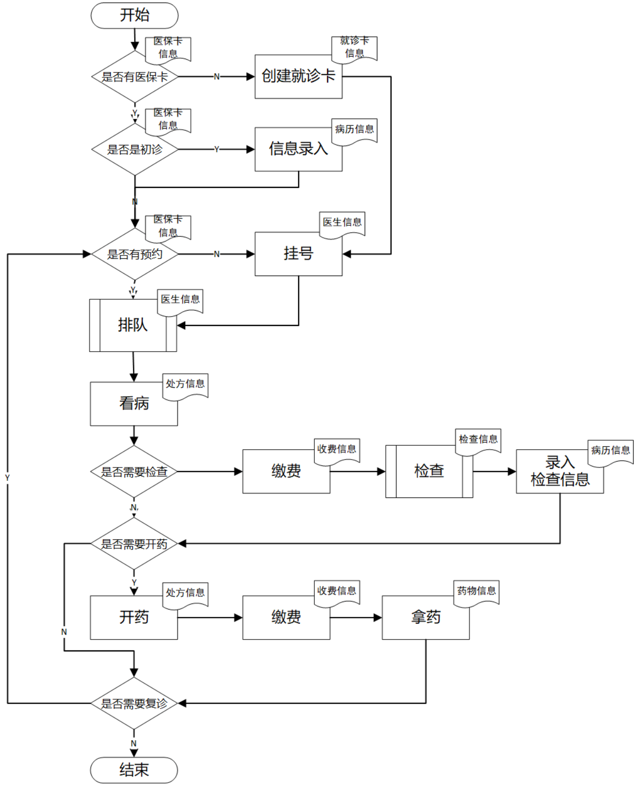

# HOIM Hospital Information Management System

[中文](README.md) | **English**

A comprehensive hospital information management system for small and medium-sized hospitals, built with **Vue 3 + FastAPI**, covering core business flows including **outpatient, inpatient, pharmacy, lab, physical examination, and billing**.

The AI platform provides [80 capabilities](doc/ai-capabilities.md): 63 text LLM tasks, plus speech, imaging, ECG, risk assessment, forecasting, optimization and fixed local statistics. Staff can submit tasks from business pages or the AI workbench. Super administrators manage models, prompts, knowledge, sources, permissions and usage in one place. The workbench groups tasks by workflow and stores favorites separately for each account and role. See the [AI usage guide](doc/ai-guide.md) for configuration and workflows.

Administrators configure role and individual access to API operations, AI capabilities, patient-directory fields and clinical data scopes. Navigation and backend checks use the same effective permissions. See the [permission management guide](doc/permission-management.md) for setup and the [verification record](doc/validation/2026-10-29-permissions.md) for authorization, revocation and concurrency results.

LLM tasks show specific guidance for authentication, rate limits, service failures and malformed responses. Bounded retries, status-query recovery, interrupted-task handling and usage audits follow the [error handling guide](doc/ai-error-handling.md).

[](CHANGELOG.md)
[](LICENSE)
[](https://vuejs.org/)
[](https://fastapi.tiangolo.com/)
[](https://www.python.org/)

---

## Project Scale

| Metric | Count |
|:------:|:-----:|
| Backend Router Modules | **135** mounted modules |
| API Endpoints | **1,092** RBAC route methods; see the [access matrix](doc/api-rbac-matrix.md) |
| Database Table Definitions | **269** ORM table definitions, including AI sources and governance |
| Frontend Pages | **161** Vue page files |
| User Roles | **11**, including super admin, lab technician, and registrar |
| AI Capability Catalog | **80** capabilities, including **63** text LLM tasks |

Source inventory: routes are checked against the RBAC matrix, tables are counted from ORM definitions, and pages under `vue3-new-ui/src/views/**/*.vue`.

---

## Features

### Core Business (9 Domains / 40+ Modules)

- **Outpatient Management** — Smart Triage, Appointment, Walk-in Registration, Check-in, Queue Management, Triage Desk, Patrol Records, Breach Records, Billing, Invoice, Daily Settlement
- **Doctor Workstation** — Scheduling, EMR, Prescription, context-aware CDSS, Lab Orders, Attendance, MDT Consultation, Clinical Pathway
- **Pharmacy** — Drug Management, Consumables, Audit & Dispense, Stock Alert, Stock Check, Purchase, Prescription Review, ADR Monitoring
- **Inpatient Management** — Ward & Bed, Admission, Inpatient Orders, barcode-verified eMAR, Nursing Station, Inpatient Charges, Discharge Settlement
- **Electronic Medical Record (EMR)** — Templates, Structured Records, Progress Notes, Ward Rounds, Quality Control, CA Digital Signature
- **Lab & Physical Exam** — Lab Orders, Results, Exam Packages, Appointments, Records, Reports
- **Surgery** — Surgery Application, Scheduling, Anesthesia Records
- **Patient Services** — Health Records, EMR Query, Prescription Query, Prepaid Account, Two-way Referral, Follow-up, Satisfaction Survey
- **System Platform** — Configurable Role/User Permissions, Patient-directory Fields, Account Suspension and Permission Audit, Operation Logs (auto-recorded by middleware), Dictionary, Parameters, Messages, Notices, Backup, Adverse Events (with RCA root-cause analysis), Slot Pool, Reports, Department Performance

### Specialized Workflows and Management

- **Prescription Review Rule Engine** — 6 rule types (interaction / contraindication / dose / duplicate / allergy-keyword / patient context); severity-3 rules **block both prescribing and dispensing**
- **Insurance Catalog Mapping** — local items ↔ insurance codes with category/self-pay ratio/price limit; template download + batch import
- **CSSD** — full instrument-pack state machine (0-6) with BD-test and biological-monitor gates
- **PIVAS** — batch flow with mandatory **dual-person check** (dispenser cannot verify own batch)
- **ICU/PACU Scoring** — server-side APACHE II / SOFA / GCS / Aldrete / Steward with discharge criteria
- **Clinical Pathway Enrollment** — enroll / progress / 4-type variation / completion-gated exit
- **MDRO Isolation / Hand Hygiene / Notifiable Disease Reporting / HQMS Indicators** — infection-control suite with auto disease-class inference and report state machine
- **Archive Borrow Approval** — request → approve/reject → return-and-reset workflow with approval desk
- **ICD Coding Workbench** — dictionary-validated binding of diagnoses/operations, single primary code, coverage stats
- **Department Performance** — (workload − cost) × coefficient computed server-side; draft → submit → audit
- **Perioperative Antibiotic Compliance / Green-channel Billing Closure / Pay-date Settlement / Scrap Batch Ledger**
- **Versioned DRG/DIP Auto-grouping / Daily Operational Aggregates / Durable Integration Outbox**

### Clinical Knowledge, Imaging and Integration

| Module | Description |
|:------:|:------------|
| Insurance and integration | Catalog mapping and batch import, settlement requests and callbacks, versioned DRG/DIP auto-grouping; integration outbox with retries, dead-letter handling and manual replay |
| Clinical knowledge and CDSS | Structured patient context, prescription and dose rules, reviewed knowledge retrieval and clinical pathway imports; rule evidence and data sources accompany results |
| Imaging services | Examination orders, report submission and review, PACS callbacks, external viewers, private single-frame DICOM registration and pixel previews |
| Patient and follow-up services | Appointments, personal encounter and prescription records, clinician follow-up plans, revisit booking and follow-up feedback |

See the [integration guide](doc/integration-guide.md) for configuration and the [user manual](doc/user-manual.md) for role-based workflows.

---

## AI Platform

The business workbench is at `/#/ai/workbench`; super-administrator management is at `/#/ai/manage`. Medical records, prescriptions, inpatient, pharmacy, laboratory and operational pages also provide entries bound to the current business record.

| Area | Features |
| --- | --- |
| Clinical assistance and documents | Patient summaries, differential diagnosis and treatment-pathway candidates, prescription review and record/report drafts; patient relationships, encounters, original records and applicable reviewed knowledge are checked per task |
| Speech, ECG and imaging | Private recordings with listening review, original WFDB files and waveforms, single-frame DICOM images and specialist adapters; optional local research services have separate preparation and verification workflows |
| Risk and fixed calculations | NEWS2, adult AKI, qSOFA, SOFA-1 daily six-axis assessments and change review, plus reviewed scheduling, bed, supply and inventory workflows; fixed calculations and model explanations remain separate |
| Sources and dedicated tasks | Complete billing records, feedback, guideline versions, drug labels, research cohorts/variables, deidentification candidates, incident RCA, finite-case statistics, operational materials and synthetic teaching |
| Document and teaching review | Document body is separate from summary, warnings and missing data; users select sections and review them before copying. Exercises and AI explanations are submitted separately; fixed scores and model feedback remain separate |

Super-administrator management provides 41 entries with search across four groups:

| Group | Main Controls |
| --- | --- |
| Features and models | Feature switches, allowed roles, providers, limits, validation status and task-prompt versions |
| Knowledge and data | Knowledge review, source registration, professional review and independent publication |
| Tasks and usage | Task tracking, results, feedback and usage statistics |
| Permissions and audit | Patient-access grants, configuration audits and management history |

**Prompt management:** 79 capabilities support individual task prompts, immutable revisions, historical version activation and task snapshots. Fixed local statistics use reviewed recipes. Clinical documents, pharmacy, operations and teaching tasks each define their content and writing requirements. Document text, evidence, missing data and review items have dedicated sections.

**Configuration and use:**

1. Sign in as `super_admin` to configure providers, credentials and feature limits.
2. Set allowed roles, task prompts, knowledge and sources; source content uses purpose-based access authorization.
3. Complete the required professional reviews, service checks and validation records, then enable the feature.
4. Submit tasks from the workbench or business pages and review sources, results and review items. Select document sections and confirm review before copying; clinicians confirm diagnosis and treatment decisions.

See the [capability catalog](doc/ai-capabilities.md) for inputs, outputs and default roles, the [usage guide](doc/ai-guide.md) for configuration, and the [integration](doc/ai-final-integration-verification.json) and [experience](doc/ai-experience-verification.json) records for tests and builds.

---

## Architecture

```
┌─────────────────────────────────────────────────────────────┐
│                  Frontend (Browser)                          │
│        Vue 3 · Element Plus · Vuex · Vue Router · Rspack    │
├─────────────────────────────────────────────────────────────┤
│                  Application (FastAPI)                       │
│       FastAPI · AI Worker · JWT/RBAC · Metrics/Audit          │
├─────────────────────────────────────────────────────────────┤
│                  Data Layer                                  │
│             SQLite (dev) / PostgreSQL (prod)                 │
│                   SQLAlchemy ORM · Alembic                   │
└─────────────────────────────────────────────────────────────┘
```

### Tech Stack

| Layer | Technologies |
|:-----:|:-------------|
| Frontend | Vue 3.5+ / Element Plus 2.x / Vuex 4 / Vue Router 5 / Axios / Rspack 2 |
| Backend | FastAPI 0.111+ / SQLAlchemy 2.x / Pydantic 2.x / Alembic |
| Database | SQLite (development only) / PostgreSQL (required in production) |
| Containerization | Docker / Docker Compose |
| Code Quality | ruff (Python) / Prettier (JavaScript) |
| Testing | pytest (backend API testing) |
| Security | bcrypt password hashing, JWT sessions, operation log auditing |

---

## Quick Start

### Local Preview

With Docker Compose, Python and Node.js installed, run from the repository root:

```bash
npm --prefix vue3-new-ui ci --legacy-peer-deps
python scripts/local_preview.py start
```

Open **http://localhost:51891**. API documentation is at **http://localhost:51800/docs**. Both listen on `0.0.0.0`; use the host IP for local network access. Sign in as `super01 / 123456` for AI administration, or `doctor1 / doctor123` for the doctor workstation.

The preview uses its own database and synthetic records. It configures simulated patient summaries, outpatient note drafts and operations Q&A. Clinical tasks retain their approval requirements and use super-admin preview. See the [local preview guide](doc/local-preview.md) for status, shutdown and SSH forwarding.

The following steps run the frontend and backend separately for development.

### Requirements

| Component | Version |
|:---------:|:-------:|
| Node.js | 24.x (container: 24.22.1) |
| npm | ≥ 10.0.0 |
| Python | 3.12.x (container: 3.12.16) |
| Database | SQLite included (no install needed) |

### 1. Clone

```bash
git clone https://github.com/Palpitate-xus/hoimsystem.git
cd hoimsystem
```

### 2. Start Backend

The API and AI worker use the same database, `SECRET_KEY` and AI configuration.

```bash
cd fastapi_be

# Create virtualenv
python -m venv venv
source venv/bin/activate    # Linux/Mac
# venv\Scripts\activate     # Windows

# Install dependencies
python -m pip install --require-hashes -r requirements-build.lock
python -m pip install --only-binary=:all: --require-hashes -r requirements.lock

# Create the configuration file; configure the database and SECRET_KEY in .env
cp -n .env.example .env

# Initialize an empty database or upgrade an Alembic-managed database
python -m app.db_migrate

# Start the API
python -m uvicorn app.main:app --reload --host 0.0.0.0 --port 8000
```

Visit http://localhost:8000/docs for the auto-generated Swagger UI. The current migration head is `20261029_session_binding`. Sign in again once after upgrading: JWT sessions bind the user ID and a unique account identity.

To process queued AI tasks, open another terminal at the repository root and use the same virtual environment and database configuration:

```bash
cd fastapi_be
source venv/bin/activate
python -m app.ai.worker
```

See the [deployment manual](doc/installation-guide.md#34-数据库初始化) for backup, schema review, migration and adoption of existing databases, and the [AI usage guide](doc/ai-guide.md) for provider and feature configuration.


### 3. Start Frontend

Open another terminal at the repository root:

```bash
cd vue3-new-ui

# Install dependencies
npm ci --legacy-peer-deps

# Dev mode (port 8091)
npm run serve:rspack

# Production build
npm run build

# Dependency audit, production build and asset-budget checks
npm run verify
```

### 4. Access

- Frontend: http://localhost:8091
- Backend API: http://localhost:8000/api
- API Docs: http://localhost:8000/docs

### 5. Docker (recommended for production)

Run from the repository root:

```bash
export POSTGRES_PASSWORD='replace-with-a-strong-database-password'
export SECRET_KEY="$(openssl rand -base64 48)"
export ALLOWED_ORIGINS='https://his.example.com'
docker compose up -d
```

See [doc/deployDoc.md](doc/deployDoc.md) for detailed deployment instructions (Nginx, HTTPS, Systemd).

---

## Local Demo Accounts

After migrating a fresh local development database, run the [demo account script](fastapi_be/seed_default_accounts.py) from `fastapi_be/` to create these accounts and the required doctor and patient profiles:

```bash
python seed_default_accounts.py
```

| Role | Username | Password | Note |
|:----:|:--------:|:--------:|:----:|
| Admin | `admin` | `admin123` | General administration |
| Super Admin | `super01` | `123456` | AI platform management; source purpose authorization checked separately |
| Director | `director01` | `123456` | Department management |
| Doctor | `doctor1` | `doctor123` | Regular doctor |
| Nurse | `nurse01` | `123456` | Nursing work |
| Cashier | `cashier01` | `123456` | Cashier desk |
| Pharmacist | `pharmacist01` | `123456` | Pharmacy work |
| Guide | `guide01` | `123456` | Guidance desk |
| Lab Technician | `lab01` | `123456` | Laboratory work |
| Registrar | `registrar01` | `123456` | Registration service |
| Patient | `patient1` | `123456` | Patient self-service |

For production, create the first super administrator interactively with a strong password. See the [deployment manual](doc/installation-guide.md#34-数据库初始化).

---

## Roles

The 11 roles define default business qualifications. Role policies and user policies determine the effective permissions for each account.

| Role | Permissions |
|:----:|:------------|
| **Admin** | Users, staff, patients, departments, pharmacy, billing, notifications, system settings and ordinary role/user permission policies |
| **Super Admin** | Administrator permissions, AI configuration, prompts, knowledge, source governance and audit; source content uses purpose-specific authorization |
| **Director** | Department management, scheduling, prescription review |
| **Doctor** | EMR writing, prescription, lab orders |
| **Nurse** | Triage, vital signs, nursing, follow-up |
| **Cashier** | Walk-in registration, billing, daily settlement |
| **Pharmacist** | Prescription audit, dispense, inventory |
| **Guide** | Triage desk, smart triage, queue |
| **Lab Technician** | Samples, results, critical values, and laboratory quality control |
| **Registrar** | Window appointment confirmation, cancellation, and patient cards |
| **Patient** | Self-service: appointments, billing, records |

---

## Documentation

| Document | Description |
|:--------:|:------------|
| [Doc Index](doc/README.md) | Navigation for all docs |
| [Architecture](doc/architecture.md) | System architecture & design decisions |
| [Frontend Development](vue3-new-ui/README.en.md) | Frontend setup, API configuration, business entries and build checks |
| [Requirements](doc/demandDoc.md) | Functional & non-functional requirements |
| [API Doc](doc/apiDoc.md) | Core definitions; [access matrix](doc/api-rbac-matrix.md) covers 1,092 RBAC route methods |
| [Database Doc](doc/databaseDoc.md) | Core definitions; 269 ORM table definitions are maintained in model source |
| [Permission Management](doc/permission-management.md) | Role/user policies, API and field permissions, data scopes, suspension, audit and session migration |
| [AI Usage Guide](doc/ai-guide.md) | Workbench, super-admin configuration, sources and activation |
| [AI Capability Catalog](doc/ai-capabilities.md) | All 80 capabilities, inputs, outputs and default roles |
| [Default Prompts](doc/ai-prompts.json) | Task instructions, catalog version and fixed system contracts |
| [AI Experience Verification](doc/ai-experience-verification.json) | Prompt, document, management navigation and business interface tests |
| [Deployment](doc/deployDoc.md) | Dev/prod/Docker deployment guide |
| [User Manual](doc/user-manual.md) | Role-based operation guide |
| [Roadmap](doc/todos.md) | Feature inventory and project planning |
| [Security](SECURITY.md) | Security policy |
| [Contributing](CONTRIBUTING.md) | Code style & PR workflow |
| [Changelog](CHANGELOG.md) | Version history |

---

<a id="performance-benchmark"></a>

## Performance Benchmark

### Reproducible PostgreSQL Harness

The benchmark uses an isolated PostgreSQL container, four Gunicorn workers, and an ephemeral data volume. Destructive initialization accepts only a database named `hoimsystem_benchmark` and requires `BENCHMARK_RESET_CONFIRM` to match it. The `smoke`, `small`, `medium`, and `large` profiles scale up to 100,000 patients and 500,000 history rows.

Run from the repository root:

```bash
cd fastapi_benchmark

# small is the default; smoke, medium, and large are also available
BENCHMARK_PROFILE=small docker compose up --build -d

# Tokens are generated by live logins; writes use valid patient and doctor roles
locust -f locust_final.py --headless -u 50 -r 10 -t 5m \
  --host http://localhost:18000 --csv=benchmark_results/mixed_50u \
  --exit-code-on-error 1

docker compose down -v
```

Every Locust request validates both the HTTP status and response-body `code == 200`. Run metadata records the commit, data profile, load parameters and redacted database target. Run the workload on target hardware with the desired data profile to record P95/P99, errors, pool waits and PostgreSQL slow queries for capacity planning. See the [performance guide](doc/performance.md).

---

## Operations and Maintenance

- RBAC drift checks, lint, business tests, dependency audits and bundle budgets: see the [testing guide](doc/testing.md).
- GitHub Actions audits all 18 Python locks and npm dependencies on pull requests, master pushes and a weekly schedule, retaining the audit reports.
- Liveness/readiness probes, Prometheus metrics, request IDs and audit logs help trace request failures, unavailable dependencies and configuration changes.
- The API, AI worker and scheduler run separately. Integration delivery supports bounded retries, dead-letter inspection and manual replay.
- Database migrations, backups, restoration and process supervision are described in the [installation guide](doc/installation-guide.md).

---

## Screenshots



More screenshots in [doc_assets/](doc_assets/).

---

## License

[MIT](LICENSE)

---

## Contributing

Issues and Pull Requests are welcome. See [CONTRIBUTING.md](CONTRIBUTING.md) for details.

**Contact**: palpitate.xus@outlook.com

Dependency locks, audit commands and image maintenance are documented in [dependency maintenance](doc/dependencies.md). Release checks and local version management are in the [release process](doc/release-process.md).
