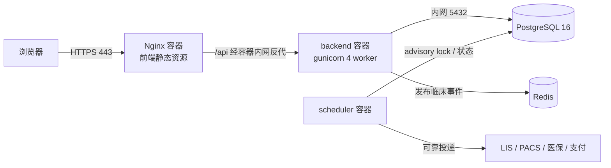

# HOIM 系统安装部署手册

> **版本**：未发布版（2026-09-03）　**适用对象**：系统实施/运维人员
> 配套文档：软件说明书（software-manual.md）· 安全上线清单（security-launch-checklist.md）

---

## 一、部署架构



七个服务编排在 `docker-compose.yml`，其中 `migrate` 为一次性任务，其余六个为常驻服务：
- **redis**：跨 worker 临床事件广播与最近事件回放，AOF 持久化
- **db**：postgres:16-alpine，仅 `expose 5432`（不映射宿主机端口），带健康检查
- **migrate**：一次性迁移服务，成功后 API 和调度器才启动
- **backend**：python:3.12-slim + gunicorn（4 worker × UvicornWorker），绑定 `127.0.0.1:8000`
- **scheduler**：库存/违约/运营聚合和集成发件箱独立调度进程
- **ai-worker**：独立处理已提交的 AI 任务，功能和模型仍须由超级管理员配置启用
- **frontend**：Nginx，80 对外（生产建议前置 TLS 或直接配 443）

---

## 二、环境准备

### 2.1 硬件

| 项 | 最低 | 推荐 |
|----|------|------|
| CPU | 2 核 | 4 核+ |
| 内存 | 4 GB | 8 GB+ |
| 磁盘 | 40 GB | 100 GB+ SSD |

### 2.2 软件依赖

```bash
# Docker 24+ 与 Compose v2
curl -fsSL https://get.docker.com | sh
docker compose version   # 确认 v2
```

---

## 三、生产部署步骤

### 3.1 获取代码

```bash
git clone <仓库地址> /opt/hoimsystem
cd /opt/hoimsystem
```

### 3.2 配置环境变量

```bash
cp fastapi_be/.env.example .env
```

编辑仓库根目录 `.env`（Compose 变量插值读取此文件）：

```ini
# 必填（生产）
ENVIRONMENT=production
POSTGRES_PASSWORD=<数据库强密码>
SECRET_KEY=<openssl rand -base64 48 生成>
ALLOWED_ORIGINS=https://his.your-hospital.cn

# 可选（启用集成时）
LIS_INTEGRATION_KEY=...
PACS_INTEGRATION_KEY=...
MEDICAL_INSURANCE_INTEGRATION_KEY=...
PAYMENT_INTEGRATION_KEY=...
LIS_OUTBOUND_URL=https://...
PACS_OUTBOUND_URL=https://...

# 可选（多 worker RSA 传输密钥共享，建议显式配置）
# TRANSPORT_RSA_PRIVATE_KEY_PEM=<PEM 内容单行转义>
```

> `ALLOWED_ORIGINS` 禁止 `*`；未配置时生产模式启动失败（fail-fast）。

### 3.3 构建与启动

以下流程适用于空库或已有有效 Alembic 版本记录的数据库。已有业务表但尚未纳入 Alembic 管理的库，先按 **3.4 的受控接管流程**完成备份、结构核对和一次性接管，再启动应用。

```bash
docker compose build
docker compose up -d
docker compose ps -a     # migrate 成功退出，其余六个服务 healthy/running
```

### 3.4 数据库初始化

部署统一使用[迁移入口](../fastapi_be/app/db_migrate.py) `python -m app.db_migrate`。Compose 的 `migrate` 服务已经配置该命令，成功退出后才启动 API、调度器和 AI worker；生产环境保持 `AUTO_CREATE_SCHEMA=false`，不依靠 API 启动补建结构。

| 目标数据库状态 | 迁移入口的处理 | 成功输出 |
| --- | --- | --- |
| 除 `alembic_version` 外没有表的空库 | 按当前模型 `metadata.create_all` 建表，再 `stamp head` 记录当前版本 | `database migration: bootstrapped` |
| 已有表，且 Alembic 版本记录有效 | 执行 `upgrade head`，按已有版本应用后续迁移 | `database migration: upgraded` |
| 已有表，但没有 `alembic_version` | 默认拒绝；完成下述核对后，显式一次性接管 | `database migration: adopted` |

空库应使用上述统一入口初始化，不直接从历史初始 revision 执行 `alembic upgrade head`：历史初始迁移没有完整建表定义。已有版本表但版本为空、无法识别或缺少对应迁移文件时，先查明来源并制定迁移方案，不能把它当作已核对的库接管。

#### 空库初始化或已跟踪库升级

```bash
# 查看一次性迁移结果，确认没有报错
docker compose logs migrate
docker compose ps -a migrate

# 应用启动后，核对数据库当前版本与当前代码的迁移 head
docker compose exec backend alembic current
docker compose exec backend alembic heads
```

非容器部署在 `fastapi_be` 目录中、使用已配置目标 `DATABASE_URL` 和生产必需参数的运行环境，执行 `python -m app.db_migrate`，随后核对 `alembic current` 与 `alembic heads`。

#### 无 Alembic 跟踪的既有库：受控接管

1. 停止旧版 API、调度器、AI worker 及其他数据库写入方。按第五节生成数据库备份，并在隔离环境验证可恢复；记录待接管库、代码版本和实际结构。
2. 将现有表、列名和类型、可空性、默认值、主外键、唯一约束及索引，与拟部署版本的模型和迁移脚本逐项比对；同时核对历史数据是否满足当前约束。存在差异时，先完成经验证的结构及数据迁移，再复查兼容性。
3. 确认兼容后，仅对本次迁移进程传入接管开关。Compose 部署执行：

```bash
docker compose stop backend scheduler ai-worker
docker compose build migrate
docker compose run --rm -e MIGRATION_ADOPT_EXISTING=true migrate python -m app.db_migrate
```

非容器部署的等效命令为：

```bash
cd /opt/hoimsystem/fastapi_be
MIGRATION_ADOPT_EXISTING=true python -m app.db_migrate
```

`MIGRATION_ADOPT_EXISTING` 由迁移进程通过 `os.getenv` 读取，必须进入该进程的环境。仅把它写进 `.env` 不会启用接管；当前 Compose 也没有将此变量转发给 `migrate` 服务。使用上面的单次命令传入即可，常规启动和后续升级不设置此开关。

接管只补建不存在的整表并将版本标记为当前 `head`，不会执行被跳过的历史迁移。`create_all` 不修改已有表的列、类型、约束或索引，因此接管不能替代结构迁移；标记为最新版本后，后续 `upgrade head` 也不会补跑此前跳过的变更。迁移入口不会替代人工结构比对，不能直接对未知 schema 执行 `stamp head`，也不能仅为了消除拒绝提示而启用接管。

看到 `database migration: adopted` 后，再执行 `docker compose up -d`，按前面的日志和版本检查确认常规迁移服务成功。保留备份、结构差异处理记录及迁移日志，供回滚和后续升级使用。

#### 创建首个管理员

```bash
# 仅在系统尚无管理员时交互式创建首个强口令超级管理员
# 将 hospital-admin 替换为实际管理员工号
docker compose exec backend python bootstrap_admin.py --username hospital-admin
```

生产环境会拒绝运行 `seed_default_accounts.py`，不得写入 `admin/admin123` 等演示账号。首个管理员创建后，其他员工账号通过系统权限管理和医院身份开通流程创建。

### 3.5 验证

```bash
# 存活与就绪检查
curl -fsS http://127.0.0.1:8000/health/live
curl -fsS http://127.0.0.1:8000/health/ready

# 前端可访问
curl -sI http://<服务器IP>/ | head -1

# 迁移版本与指标
docker compose exec backend alembic current
curl -fsS http://127.0.0.1:8000/metrics | head
```

功能冒烟：浏览器打开 `http://<服务器IP>`，用刚创建的管理员登录，依次点开“医生管理/挂号/报表”确认无 500。

---

## 四、HTTPS 配置（生产必须）

方案 A：在现有 Nginx 容器配置证书（修改 `vue3-new-ui/nginx.conf` 增加 443 server 块）。

方案 B（推荐）：前置独立 TLS 网关/负载均衡，转发到 Nginx 80。

证书要求：正规 CA 签发，覆盖医院域名；JKS/PEM 均可，Nginx 用 PEM。

配置后验证：`curl -sI https://his.your-hospital.cn` 返回 200，且 `curl -I http://...` 301 跳转 https。

---

## 五、数据备份策略

| 环境 | 方式 | 说明 |
|------|------|------|
| 生产 PostgreSQL | `pg_dump` + WAL 归档 | 每日全量；备份页面在 PG 模式返回 501 |
| 开发 SQLite | 系统管理 > 数据备份 | 页面一键备份/恢复/下载 |

```bash
# 每日 02:00 备份示例（cron）
0 2 * * * docker compose -f /opt/hoimsystem/docker-compose.yml exec -T db \
  pg_dump -U hoimsystem -d hoimsystem | gzip > /backup/hoimsystem-$(date +\%F).sql.gz
```

恢复演练每季度一次：将包含结构和数据的完整备份恢复到独立空库，核对恢复后的版本记录并抽查患者、收费数据，再按目标发布版本升级。无 Alembic 跟踪的备份按 **3.4 的受控接管流程**处理。不要先按当前模型建表，再叠加恢复包含完整结构的旧库备份。

---

## 六、升级发布

1. 停止旧版应用写入，备份数据库并确认恢复方案；Compose 部署停止 `backend`、`scheduler` 和 `ai-worker`。
2. 拉取目标发布版本并构建镜像。确认目标库已有有效 Alembic 记录；无跟踪既有库须先完成 **3.4 的受控接管流程**。
3. 先单独运行迁移，成功后再启动应用：

```bash
docker compose stop backend scheduler ai-worker
git pull
docker compose build
docker compose run --rm migrate python -m app.db_migrate
# 上一命令成功退出后执行
docker compose up -d
docker compose logs migrate
```

4. 确认一次性 `migrate` 服务成功退出，`alembic current` 与当前代码的 `alembic heads` 一致，`/health/ready` 返回 200。迁移失败时保留停止状态，按日志排查，不手工跳过版本。
5. 冒烟验证（登录/挂号/收费各走一遍）。
6. 回滚时切回旧发布版本；若迁移不可向后兼容，则按发布方案恢复备份。

详细流程见 `doc/release-process.md`。

---

## 七、监控与日志

| 内容 | 位置 |
|------|------|
| 应用日志 | `docker compose logs -f backend`（stdout） |
| 操作审计 | 系统管理 > 操作日志（DB 持久化） |
| 系统监控 | 系统管理 > 系统监控（CPU/内存/连接数/业务指标） |
| Nginx 访问日志 | `docker compose logs frontend` |

告警接入与 Runbook 见 `doc/monitoring.md`。

---

## 八、故障排查

| 现象 | 排查 |
|------|------|
| backend 起不来 | `docker compose logs backend`；多半是必填环境变量缺失（SECRET_KEY/POSTGRES_PASSWORD/ALLOWED_ORIGINS） |
| 登录 429 | 登录失败锁定（5 次/5 分钟），等 5 分钟或查 `hoimsystem_login_lockouts` 表 |
| 多 worker 登录随机失败 | RSA 密钥未共享：配置 `TRANSPORT_RSA_PRIVATE_KEY_PEM` 或确认密钥文件路径 4 worker 可写 |
| 前端 502 | backend 未起或 8000 端口未绑 127.0.0.1；`docker compose ps` 检查 |
| 迁移报 MultipleHeads | 本仓库已用 merge revision 归一；若出现请 `alembic heads` 检查是否有未提交的分叉迁移 |

更多见 `doc/troubleshooting.md`。

---

## 九、安全加固清单（上线阻断项）

1. [ ] 未运行演示账号脚本；首个管理员通过 `bootstrap_admin.py` 使用独立强口令创建
2. [ ] SECRET_KEY / POSTGRES_PASSWORD / ALLOWED_ORIGINS 已配置
3. [ ] HTTPS 已启用
4. [ ] DATABASE_URL 指向 PostgreSQL（禁 SQLite）
5. [ ] 集成密钥已配置（若启用 LIS/PACS/医保/支付）
6. [ ] TRANSPORT_RSA_PRIVATE_KEY_PEM 已配置（多 worker）
7. [ ] 镜像内无 *.db / backups（.dockerignore 已处理，构建镜像后人工验证）

完整清单：`doc/security-launch-checklist.md`
